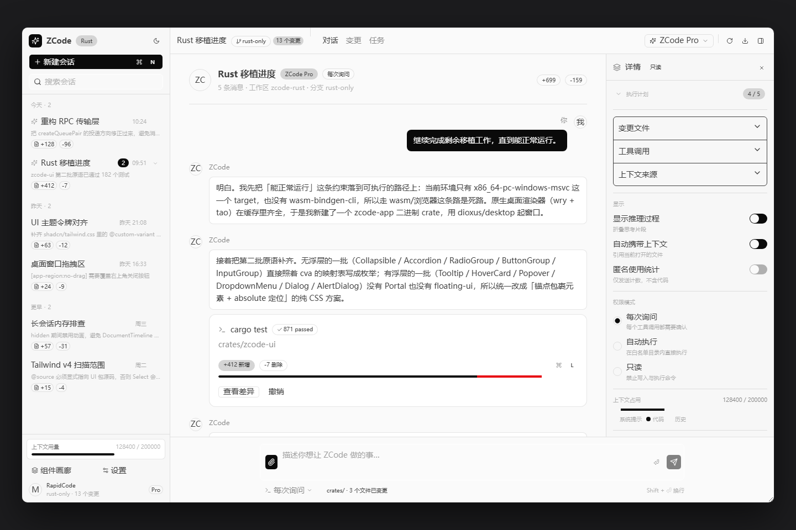
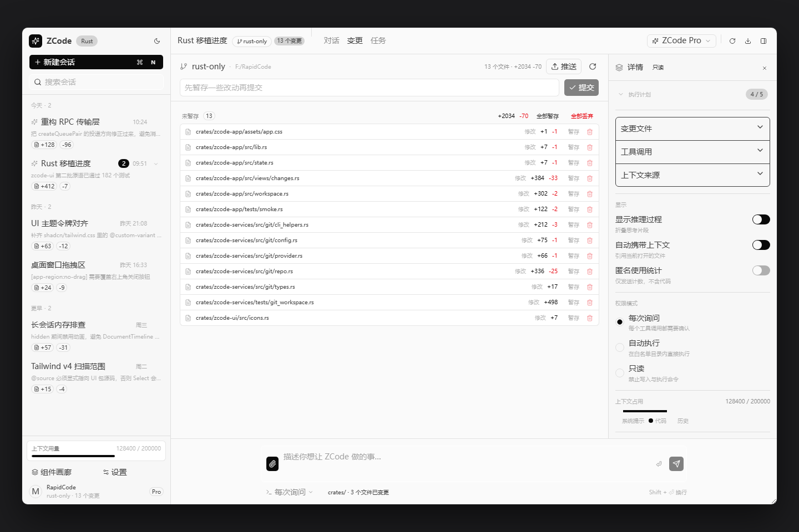

# ZCode Rust 移植

> **本分支（`rust-only`）只保留 Rust 代码。**
> 移植所依据的 TypeScript 源码**不在这里** —— 它保留在 `rust` 分支
> （= `main` + 本目录内容）。本文档与 `PORTING.md` / `PORTING-UI.md` 里出现的
> `packages/**`、`apps/**` 路径都是**移植来源**，用于追溯「这段 Rust 是从哪个
> TS 文件翻译过来的」，在 `rust` 分支上才能打开。

本仓库是 **RapidCode / ZCode 的 Rust 移植**。分四批推进：

1. **核心逻辑层**（移植自 `packages/rpc` + `packages/shared`）—— 见 **[PORTING.md](./PORTING.md)**
2. **UI 层**（移植自 `packages/ui` 的 shadcn 风格原语，**47 / 47**）—— 见 **[PORTING-UI.md](./PORTING-UI.md)**
3. **应用外壳**（`crates/zcode-app`）—— 用移植出的原语拼出的 ZCode 风格界面
4. **真实业务链路**（移植自 `packages/services`）—— 见 **[PORTING.md](./PORTING.md) §2.4**

**当前状态，请先读这一句**：**可编译、可测试**已经做到（`cargo build` 零警告、
1028 个测试全绿），但**桌面窗口渲染不出内容**（环境层面的依赖不兼容，见「已知问题」）。

**应用外壳已经能显示并修改真实数据**：「变更」页走的是**真正移植过来的 git 工作区状态链路**
（`crates/zcode-services`）—— 它会真的去 `git status --porcelain=v2` / `git diff --numstat`，
界面上列出的分支名、变更文件、`+N/-M` 全部来自你当前这份仓库，不是硬编码；
`暂存` / `取消暂存` / `丢弃` / `提交` / `推送` 五个动作也是真的在跑 `git`。
见下方 [截图](#能看的东西ssr-静态快照) 与 [§真实业务链路](#真实业务链路git-工作区状态)。

**但请不要误解规模**：已移植的是 **UI 原语层**（47/47）加 **git 这一条服务链路**；
上游 8,462 个 `.ts` / `.tsx` 里其余承载业务逻辑的部分基本还没动，
范围明细见「已知问题 · 移植范围」。

## 快速开始

```bash
cargo build                          # 编译整个工作区
cargo test                           # 运行全部测试（1028 个）
cargo run -p zcode-app               # 桌面窗口（⚠️ 本机开得出窗口但内容是空白，见「已知问题」）
cargo build --release

# UI 预览（生成可直接在浏览器打开的 HTML）—— 这是目前唯一能看到 UI 的路径
cargo run -p zcode-ui --example preview       # → ./preview.html            （原语清单）
cargo run -p zcode-app --example app_preview  # → ./app-preview.html        （对话页整屏快照）
                                              #   ./app-preview-changes.html（变更页整屏快照，真实 git 数据）
```

> **`app_preview` 会真的跑一次 git 查询**：它同步调用 `zcode-services` 里那套移植过来的
> 代码读当前工作区，把结果注入界面。所以快照里列的文件名、`+N/-M` 就是你这份仓库的
> 真实状态。换个目录跑（`ZCODE_WORKSPACE=/path/to/repo cargo run -p zcode-app --example app_preview`）
> 就会换一批内容。

> `zcode-rpc` / `zcode-shared` / `zcode-services` **零外部依赖**（只用 `std`），
> 离线也能编译。其中 `zcode-services` 跑 git 只用 `std::process`，没有 `tokio`、
> 没有 `serde`、连正则都没引（`porcelain` / `numstat` 全是手写解析）。
> `zcode-ui` 依赖 Dioxus，但默认关掉了所有渲染器 feature，因此同样离线可编译、
> 可测试（`cargo test` 首次需联网拉取 dev-dependency `dioxus-ssr`）。
> `zcode-app` 默认走 `dioxus/desktop`（wry + tao 原生窗口），不需要 wasm 工具链。
> 开窗依赖系统已安装 **WebView2 Runtime**（Windows 10/11 通常自带）。
>
> 实测环境：WebView2 Runtime `154.0.4258.62`（Windows）。
>
> ⚠️ **`cargo run -p zcode-app` 能开出窗口，但窗口内容区是空白的** —— UI 渲染不出来。
> 这是 dioxus-desktop 0.6.3（wry 0.45）与较新 WebView2 Runtime 的兼容性问题，
> **与本仓库代码无关**（`cargo build` 零警告、1028 个测试全绿，SSR 渲染出的组件树
> 也完整正确）。完整证据链与可选出路见「已知问题」一节。
> 想直接看 UI，用浏览器打开 `app-preview.html` / `app-preview-changes.html`
> （SSR 静态快照），或直接看下面的截图。

## 工作区结构

```
.                                   # 仓库根 = Cargo workspace 根
├── Cargo.toml                      # workspace 根
├── Cargo.lock
├── LICENSE                         # Apache 2.0（沿用上游）
├── PORTING.md                      # 逻辑层移植说明
├── PORTING-UI.md                   # UI 层移植说明
├── preview.html                    # 原语清单预览页（由 zcode-ui 的 example 生成）
├── app-preview.html                # 对话页整屏快照（由 zcode-app 的 example 生成，自包含）
├── app-preview-changes.html        # 变更页整屏快照（同上，含**真实 git 工作区数据**）
├── docs/                           # 上面两份快照的截图（README 里引用）
├── .tailwind-build/                # 生成 app.css（见 PORTING-UI.md §4.8）
│   ├── build.sh                    #   拼装入口 CSS + 调 Tailwind CLI
│   ├── tokens.css                  #   设计令牌（vendored 自上游 styles.css 的 @theme / .dark）
│   └── package.json                #   只用 @tailwindcss/cli + tw-animate-css
└── crates/
    ├── zcode-rpc/                  # 核心：VS Code 风格 IPC/RPC 框架（完整移植）
    │   └── src/
    │       ├── foundation.rs            Layer 0  Event / Emitter / Disposable / CancellationToken
    │       ├── buffer.rs                Layer 0.5 VSBuffer
    │       ├── value.rs                 动态值 + JSON/Base64 编解码
    │       ├── error.rs                 RpcError
    │       ├── promise.rs               回调式 Promise（零依赖异步）
    │       ├── serialization.rs         Layer 1  VQL 序列化
    │       ├── protocol.rs              Layer 2  IMessagePassingProtocol / SocketProtocol / ChunkStream
    │       ├── persistent_protocol.rs   Layer 2+ ACK / 心跳 / 重放 / 流控
    │       ├── channels_shared.rs       Layer 3  通道契约
    │       ├── channel_server.rs        Layer 3  ChannelServer
    │       ├── channel_client.rs        Layer 3  ChannelClient
    │       ├── delayed_channel.rs       Layer 3  延迟通道
    │       ├── ipc.rs                   Layer 4  IPCServer / IPCClient / StaticRouter
    │       ├── proxy_channel.rs         Layer 5  ProxyChannel
    │       ├── remote.rs                Layer 6  远程连接
    │       ├── logging_middleware.rs    中间件：RPC 日志
    │       └── network_telemetry_middleware.rs  中间件：网络遥测
    ├── zcode-shared/               # 共享核心逻辑（部分移植）
    │   └── src/
    │       ├── line_change_stat.rs       行级 LCS 变更统计
    │       ├── model_provider_family.rs  模型供应商族归一 / 可见性
    │       ├── plan_identity.rs          套餐身份解析
    │       └── git.rs                    git 领域类型（分支 / 变更 / diff 可用性）
    ├── zcode-services/             # 服务层业务逻辑（起步：git 工作区状态链路）
    │   ├── src/
    │   │   ├── git/config.rs             git 环境净化 / 二进制探测 / 路径归一
    │   │   ├── git/provider.rs           std::process 跑 git（超时 / 输出上限 / 强制 kill）
    │   │   ├── git/cli_helpers.rs        porcelain v2 / numstat 解析（纯函数）
    │   │   ├── git/repo.rs               GitCliRepo：resolve / get_status / list_local_branches
    │   │   ├── git/changes.rs            按暂存区分组 + 汇总（对齐 gitService.getChanges）
    │   │   └── git/types.rs              解析中间态类型
    │   └── tests/git_workspace.rs        真起临时仓库跑端到端（6）
    ├── zcode-ui/                   # UI 原语组件库（Rust + Dioxus 移植自 packages/ui）
    │   ├── src/
    │   │   ├── cn.rs                     类名合并（clsx + tailwind-merge 子集）
    │   │   ├── icons.rs                  内联 lucide 图标（零图标库依赖）
    │   │   ├── code_preview_preferences.rs  代码预览主题白名单
    │   │   ├── keyboard_shortcuts.rs     快捷键平台判定（mac / 非 mac）
    │   │   ├── presentation_element_model.rs  PPTX 元素命中测试模型
    │   │   ├── patch_diff_preview.rs     diff 预览的纯数据层
    │   │   ├── shiki_highlighter.rs      shiki 的 trait 抽象
    │   │   ├── pdf_js_assets.rs          pdf.js 资源路径解析
    │   │   ├── pdf_zoom_overlay.rs       缩放浮层的双缓冲状态
    │   │   ├── diffs_highlighter_engine.rs  高亮引擎的纯决策层
    │   │   └── components/               47 个 shadcn 风格原语 + overlay.rs 定位约定
    │   │       ├── 基础     button  badge  card  alert  input  textarea  label
    │   │       │            separator  progress  kbd  spinner  avatar  switch  checkbox  tabs
    │   │       ├── 折叠类   collapsible  accordion
    │   │       ├── 组合型   radio_group  button_group  input_group  scroll_area
    │   │       ├── 浮层类   tooltip  hover_card  popover  dialog  alert_dialog  dropdown_menu
    │   │       ├── 展示/动画 brand  glm_icon  scroll_fade_viewport  toast  select  command
    │   │       │            context_menu  resizable  floating_particles
    │   │       │            smooth_metric_value  flip_metric_value
    │   │       └── 重型预览 carousel  chart  code_viewer  diff_viewer  pdf_viewer
    │   │                    pptx_preview_viewer  lightweight_diff_preview
    │   │                    highlighted_lightweight_diff_preview  pptx_selection_action_bar
    │   ├── tests/
    │   │   ├── render.rs                 mutation 记录式渲染测试（11）
    │   │   └── html_snapshot.rs          dioxus-ssr HTML 快照测试（75）
    │   └── examples/preview.rs           预览页生成器
    └── zcode-app/                  # 可运行的桌面应用（用上面三个 crate 拼出来）
        ├── assets/app.css                由 .tailwind-build/build.sh 生成（117,728 字节）
        ├── src/
        │   ├── lib.rs                    App / AppShell / WorkspaceBootstrap，内嵌样式表
        │   ├── main.rs                   桌面入口（LaunchBuilder::desktop）
        │   ├── state.rs                  AppState / AppCtx / demo_state
        │   ├── workspace.rs              真实工作区数据的后台线程桥（futures-channel）
        │   └── views/                    sidebar / topbar / conversation / composer
        │                                 detail / settings / gallery / changes
        ├── examples/app_preview.rs       整屏静态快照生成器（对话页 + 变更页）
        └── tests/
            ├── smoke.rs                  整树冒烟测试（30 + 1 ignored）
            └── workspace_loader.rs       跨线程取数 / 写操作链路测试（6）
```

## 设计要点（逻辑层）

| 主题 | TypeScript 原实现 | Rust 移植 |
| --- | --- | --- |
| 事件系统 | `Event<T>` = 回调函数 | `Event<T>` 结构体（`Arc<dyn Fn>` 订阅） |
| 异步结果 | 原生 `Promise` | 零依赖回调式 `Promise<T>`（`Mutex` + `Condvar`） |
| 动态载荷 | `any` | `Value` 枚举（含 JSON / Base64 编解码） |
| 定时器 | `setTimeout` / `setInterval` | `std::thread` + `sleep` + 停止标志 |
| 传输 | 接口 | `MessagePassingProtocol` trait；`create_queue_pair` 供测试 |
| 上下文 | 泛型 `TContext` | 统一用 `Value` 承载（本身可序列化） |

## 设计要点（UI 层）

| React 生态 | Rust / Dioxus 等价物 |
| --- | --- |
| JSX | RSX（`rsx! { ... }`） |
| 函数组件 / `useState` | `#[component] fn` / `use_signal` |
| `useContext` / `Provider` | `use_context` / `use_context_provider` |
| `cva`（class-variance-authority） | 枚举 + `classes()` |
| `clsx` + `tailwind-merge` | `cn()` / `cn_opt()` |
| Radix `data-state` / `data-orientation` | 手写同名属性（保住 `@custom-variant` 语义） |
| Radix `Portal` + `@floating-ui` | 锚点包裹层 + `absolute` 类名（见 `components/overlay.rs`） |
| lucide-react | `icons.rs` 内联 SVG（零依赖） |

## 测试

```
cargo test                    # 工作区 1028 个测试
cargo test -p zcode-ui        # UI 层 828 个测试
cargo test -p zcode-services  # 服务层 111 个测试（含真起临时仓库的端到端）
cargo test -p zcode-app       # 应用层 61 个测试
```

| crate | 单元 | 集成 | 小计 |
| --- | ---: | ---: | ---: |
| `zcode-rpc` | 10 | — | 10 |
| `zcode-shared` | 18 | — | 18 |
| `zcode-services` | 91 | 20 | 111 |
| `zcode-ui` | 742 | 75 + 11 | 828 |
| `zcode-app` | 25 | 30 + 6 | 61 |
| **合计** | **886** | **142** | **1028** |

- **逻辑层**：VQL 序列化往返、嵌套 `Uint8Array` 的 JSON 回退、Base64、
  事件缓冲、基于内存队列（`create_queue_pair`）的端到端 RPC 调用 / 事件订阅。
- **UI 层**：类名 / 几何 / 键盘 / 格式化的纯函数断言（742）、mutation 记录式
  渲染（11）、`dioxus-ssr` HTML 快照（75）—— 全部不需要 wasm / 窗口 / 浏览器。
- **服务层**：`porcelain=v2` / `numstat` 解析与路径归一的纯函数断言（91）；
  以及**真起临时 git 仓库**跑端到端的集成测试（20）—— 建仓库、造提交、
  改文件、建未跟踪目录，再验证解析结果，其中 14 条覆盖写操作
  （`stage` / `unstage` / `discard` / `commit` / `push` 的成与不成）。
  没有 git 时这些测试会跳过并打印说明。
- **应用层**：整棵应用树（含三个浮层）真渲染一遍，断言区域文案、
  `data-slot` 锚点、`data-*` 语义属性、浮层默认关闭、内嵌样式表覆盖到了
  所需的 `@custom-variant` 与设计令牌，以及写操作入口（逐行暂存 / 整组暂存、
  提交框、推送按钮、丢弃确认弹窗、成功 / 失败提示条）（30）；
  另有一组用**手写 executor** 驱动
  `refresh / run → 后台线程 → 通道 → 结果` 整条链路、不依赖 dioxus 运行时的
  测试（6），覆盖「加载成功 / 不是仓库 / 重复刷新被忽略 / 暂存后重新扫描 /
  失败也要刷新 / 丢弃真的改了磁盘」。

> 「能正常运行」的判定方法（进程存活 / `MainWindowHandle` 非零 /
> `MainWindowTitle` 与 `WindowBuilder` 一致 / `Responding=True`）见
> [PORTING-UI.md](./PORTING-UI.md) §5.5。

## 真实业务链路：git 工作区状态

这是目前**唯一一条端到端跑通真实 IO 的链路**，落在 `crates/zcode-services`
（移植自 `packages/services/src/git/*`）。

```
git 进程 ──► provider.rs ──► cli_helpers.rs ──► repo.rs ──► changes.rs ──► workspace.rs ──► 界面
            跑命令/超时     porcelain v2       GitCliRepo  按暂存区    后台线程 + 通道
                            解析（纯函数）      get_status   分组         （futures-channel）
                                               + 写操作 ↑
```

| 环节 | 说明 |
| --- | --- |
| `config.rs` | 清掉 `GIT_DIR` / `GIT_WORK_TREE` 等 16 个环境变量（否则在 git hook 里跑会被带偏），强制 `LC_ALL=C`、`GIT_PAGER=cat`；探测 Windows 下 4 个常见 `git.exe` 位置 |
| `provider.rs` | 只用 `std::process`（**零第三方依赖**）；每根管道一个读取线程（否则管道缓冲区满会死锁）；超时后 `kill` + 汇总诊断信息；支持**单条命令的环境变量覆盖**（在清理之后叠加，顺序与上游 `{ ...createCommandEnv(), ...command.env }` 一致） |
| `cli_helpers.rs` | 手写解析 `--porcelain=v2 -z` 与 `--numstat -z`，**不用正则**（本 crate 零依赖）；重命名记录会吃掉下一条空记录；`normalizeInputPath` 等价物把用户给的相对路径**以 workspace（不是 repo 根）为基准**解析、`realpath` 后转成仓库相对路径并拒绝越界 |
| `repo.rs` | `rev-parse --show-toplevel --show-prefix --absolute-git-dir --git-common-dir` 定位仓库；未跟踪文件按 4 线程池数行（>1 MiB 跳过、含 NUL 视为二进制）；写操作 `stage` / `unstage` / `discard` / `commit` / `push` 就在同一层 |
| `changes.rs` | 对齐 `gitService.getChanges`：一个 `MM` 状态会**同时**产出「已暂存」和「未暂存」两条变更（是展开，不是过滤） |
| `workspace.rs` | 把同步阻塞的调用挪到后台线程，用 `futures-channel` 唤醒 dioxus（**不用轮询定时器**，也不引入 tokio）；`refresh` 与 `run` 共用一个 `busy` 原子量，**所有 git 操作串行化**（并发的 `git add` 与 `git commit` 会争 `index.lock`） |

写操作的三条约定（见 `repo.rs` 上的文档注释）：

1. 先做前置检查 —— 没有 git、或 workspace 不在仓库里，都报 `RepositoryUnavailable`；
2. 路径一律先过 `normalize_input_paths`，空列表是 **no-op**（不报错，也不跑 git）；
3. 写操作**不返回新状态**，调用方自己重新扫描一遍 —— 界面因此在动作完成后
   先收到一条 `Notice`（成功 / 失败），再收到刷新后的 `Loaded`。

**没移植的**（有意为之，避免「看起来移植了其实没有」）：`gitCommitMessageGenerator`
（依赖 LLM）、`gitCheckpoint*`（依赖检查点存储），以及 `commit` 的
`stagedOnly` 部分提交变体（上游靠临时 `GIT_INDEX_FILE` 实现）。
明细写在 `crates/zcode-services/src/lib.rs` 的模块文档里。

## 已知问题：原生窗口渲染不出内容（WebView2 运行时崩溃）

**结论先说**：`cargo run -p zcode-app` 能开出一个标题正确的窗口，但**窗口内容区一片空白**
—— UI 渲染不出来。这是 **dioxus-desktop 0.6.3（内置 wry 0.45）与 WebView2 Runtime
`154.0.4258.62` 之间的兼容性问题，不是本仓库代码的问题**。同一份代码
`cargo build` 零警告、1028 个测试全绿；SSR 渲染出的组件树也完整正确（见下方
「能看的东西」）。

### 证据链

1. **页面本身加载正常**。往 `</head>` 注入自检脚本后用
   `window.ipc.postMessage` 回读（这条通道可靠，`initialize` 已证明可用）：
   `parse` / `domready` / `load` 三条都在页面时间 200 ms 内到达，
   且此时 `window.interpreter` 已存在。

2. **解释器启动正常**。包住解释器方法后可以看到
   `initialize()` 与 `waitForRequest()` 都正常进入并返回
   （`waitForRequest-enter h=true`）。顺带确认 `headless=true` 是 dioxus 的设计：
   `webview.rs:228` 里 `headless = !cfg.window.window.visible`，而
   `app.rs::handle_start_cause_init` 总是先 `with_visible(false)` 避免白屏闪烁。

3. **DOM 变更送不到页面**。`#main` 始终 0 个子节点；`run_from_bytes`（解释器应用
   DOM 变更的唯一入口）要么根本不被调用，要么被调用后页面立刻死亡。
   页面在「收不到变更」时能一直存活（心跳每秒正常回读），说明**不是 JS 线程被阻塞**。

4. **WebView2 会自行崩溃**。`<exe>.WebView2/EBWebView/Crashpad/reports/` 下会**自行**
   出现崩溃转储（没有任何外力 kill），元数据为：

   ```
   ApplicationName=msedgewebview2.exe
   ApplicationVersion=154.0.4258.62
   ModuleName=msedge.dll
   ProcessType=browser
   SubCode=0x80000003        ← STATUS_BREAKPOINT，msedge.dll 里的 CHECK 失败
   ```

5. **宿主进程不受影响**。渲染进程死掉后 `zcode-app.exe` 仍然存活、`Responding=True`、
   `MainWindowHandle` 非零。所以「进程活着 + 有窗口句柄 + 标题正确」**都不能**用来
   判定「能正常运行」—— 之前正是只看了这几项，才把「空白窗口」误判成「已跑通」。

### 为什么在本机修不了

dioxus-desktop 在 Windows 上靠**「http 伪装的自定义协议」**传 DOM 变更：
`protocol.rs` 里 `EDITS_PATH = "http://dioxus.index.html/__edits"`，由 wry 的
`AddWebResourceRequestedFilter("http://dioxus.*")` 拦截后转交 dioxus 的处理器
（wry `webview2/mod.rs:794` 与 `:940-943`：注册 `http://<name>.*` 过滤器，命中后把
`http://<name>.` 前缀重写回 `<name>://`）。解释器用长轮询不断 fetch 这个端点。
这条链路在 WebView2 `154.0.4258.62` 上不可靠，且会触发 `msedge.dll` 崩溃。

可选出路，都受本机条件限制：

| 出路 | 本机可行性 |
| --- | --- |
| 换一个 WebView2 Runtime 版本 | ❌ 只装了 `154.0.4258.62` 一个版本 |
| 升级 dioxus 到 0.7（换掉这套协议实现） | ❌ 离线缓存只有 `dioxus 0.6.3`，且无网络 |
| 改走 `--features web`（浏览器渲染器） | ❌ 只装了 `x86_64-pc-windows-msvc` target，无 wasm 工具链 |
| 把 `dioxus-desktop` 的 wry 依赖换成缓存的 `0.53.5 / 0.54.2 / 0.55.1` | ⚠️ 缓存里有，但 0.45 → 0.53 的 API 改动很大，需要 vendor 后改写 |

### 调试过程中被证伪的三个假设

**「WebView2 154 与 wry 0.45 不兼容，所以建不出 WebView」** —— 不成立。裸
`wry 0.45 + tao 0.30` 建 WebView 在全部变体下都成功，完整复刻 dioxus 的参数链也成功。
建窗这一步没问题，问题在**建完之后传 DOM 变更**。

**「`dioxus://` 协议没注册导致 `E_INVALIDARG`」** —— 只在一个刻意构造的二分变体里成立
（保留 `dioxus://` URL 但去掉协议注册）。`LaunchBuilder::desktop()` 会自动注册，
正常路径不会遇到。另外反复快速启停时偶发的 `E_INVALIDARG` 属 WebView2 侧进程竞争
（上一次实例被强杀、用户数据目录还没释放），确认无残留 `msedgewebview2.exe` 后重试即可。

**「窗口打开约 20 秒后静默退出」** —— 是渲染进程崩溃的**伴生现象**，不是独立问题。
用 `Config::with_custom_event_handler` 抓事件流可见全程没有 `CloseRequested` /
`Destroyed`，但崩溃转储会自行出现；崩溃时机不确定，所以进程存活时长在 20 秒到
数小时之间随机。

### 移植范围（避免误解）

「47 / 47 已移植」指的是 **UI 原语这一层**，不是整个应用：

| 层 | 状态 |
| --- | --- |
| `packages/ui/src/components/ui`（shadcn 原语，47 个 TSX） | ✅ 全部移植到 `crates/zcode-ui` |
| 逻辑原语（`zcode-rpc` / `zcode-shared`） | ✅ 移植了一部分（VQL 序列化往返、Base64、事件缓冲、内存队列 RPC） |
| `crates/zcode-app`（应用外壳） | ✅ 界面全部用真实原语渲染；**「变更」页已是真实数据，并且可操作**（见上一节），其余页面仍是演示数据 |
| `packages/services`（674 个文件） | ⚠️ **起步**：git 工作区状态这一条链路已完整移植（`crates/zcode-services`），其余未动 |
| `packages/shared`（419 个模块） | ⚠️ 只移植了 4 个 |
| `packages/desktop`（1,232 个文件） | ❌ 未移植 |
| `apps/`（5,060 个文件） | ❌ 未移植 |

上游 `main` 分支共 8,462 个 `.ts` / `.tsx` 文件。所以「移植完成」只在
**UI 原语这一层**成立；让它变成可用产品的那部分基本还没动 ——
目前**唯一**一条端到端跑通真实 IO 的是 git 工作区状态。

### 能看的东西：SSR 静态快照

窗口渲染不出来，但**整棵组件树本身是正确的**。用 SSR 把它渲染成 HTML 就能看到：

```bash
cargo run -p zcode-ui  --example preview       # → ./preview.html             （47 个原语清单）
cargo run -p zcode-app --example app_preview   # → ./app-preview.html         （对话页整屏快照）
                                               #   ./app-preview-changes.html （变更页，真实 git 数据）
```

`app-preview.html` 含 11,000+ 字可见文本、331 个 `data-slot` 锚点，
配色 / 圆角 / 字号都来自上游抽取并 vendored 的设计令牌 —— 用浏览器打开即所见即所得。
（这两个数字会随你仓库的真实状态浮动。）

下面这两张就是用 Chromium 无头模式把快照截出来的（脚本见下方），
内容随你当前仓库的真实 git 状态变化：

**对话页**（`app-preview.html`）



**变更页**（`app-preview-changes.html`）—— 左上角分支 `rust-only`、
工作区路径 `F:/RapidCode`、`18 个文件 · +2257 -75`、以及每个文件的
`修改 / 新增` 与 `+N/-M` 全部来自真实 git 查询；右上角的 `推送` / `提交`、
每个分组上的 `全部暂存` / `全部丢弃`、每行的 `暂存` 与垃圾桶按钮，
都是这一轮新接上的写操作入口：



```bash
# 重新生成截图（需要 Edge 或 Chrome）
EDGE="/c/Program Files (x86)/Microsoft/Edge/Application/msedge.exe"
"$EDGE" --headless=new --disable-gpu --hide-scrollbars --window-size=1440,960 \
        --screenshot=docs/screenshot-changes.png "file://$PWD/app-preview-changes.html"
```

判断「能正常运行」的完整观测清单见 [PORTING-UI.md](./PORTING-UI.md) §5.5。
